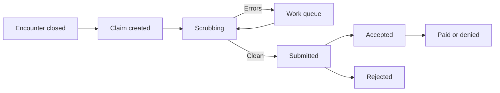

Insurance Billing builds claims from completed encounters, checks them for errors, and sends them to payers through the clearinghouse.

## Claim lifecycle

## Claim scrubbing

Every claim runs through more than 400 rules before submission. Rules check for:

- Missing or invalid patient demographics
- CPT and ICD-10 code mismatches
- Missing modifiers (for example, anesthesia modifiers AA, QK, and QX)
- Payer-specific formatting requirements
- Timely filing limits

Claims that fail a rule move to **Claims** > **Work queue** with the failed rule and a suggested fix.

## Submit claims

<Steps>
  <Step title="Review the queue">
    Open **Claims** > **Ready to submit**.
  </Step>
  <Step title="Select claims">
    Select individual claims or use **Select all clean claims**.
  </Step>
  <Step title="Submit">
    Select **Submit to clearinghouse**. Claims are sent in the next batch, every 15 minutes.
  </Step>
</Steps>

## Supported formats

| Format | Use |
| --- | --- |
| 837P | Professional claims |
| 837I | Institutional claims |
| CMS-1500 (paper) | Payers that do not accept electronic claims |

<Warning>
  Paper claims take 2 to 4 weeks longer to process. Use electronic submission whenever the payer supports it.
</Warning>
