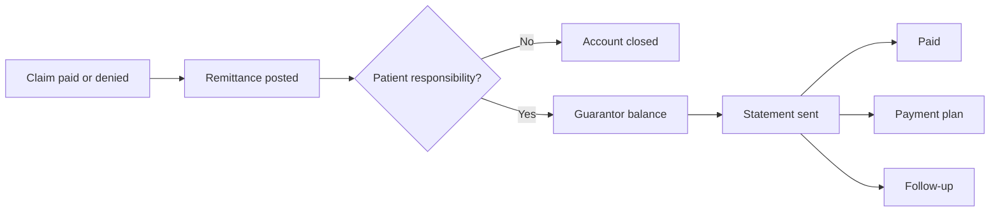

Guarantor billing collects the patient responsibility portion of a claim from the guarantor, the person financially responsible for the account. The guarantor is usually the patient. For a minor or a dependent adult, it is often a parent, spouse, or legal guardian.

## How a balance moves to the guarantor

When Insurance Billing posts a remittance (835) file, it moves any amount with a Patient Responsibility (PR) group code to the guarantor balance. Common examples:

| Code | Description |
| --- | --- |
| PR-1 | Deductible amount |
| PR-2 | Coinsurance amount |
| PR-3 | Copay amount |
| PR-96 | Non-covered charge |

Balances from a denied claim stay with the payer until the denial is resolved. See [Denial management](/insurance-billing/denial-management).

## Add or change a guarantor

1. Open the patient record.
2. Select **Billing** > **Guarantor**.
3. Choose **Patient is guarantor**, or select **Add guarantor** and enter the guarantor's name, relationship to the patient, mailing address, phone, and email.
4. Select **Save**.

Changes apply to new statements. Balances already on a sent statement stay with the original guarantor until you select **Transfer balance**.

<Tip>
  Confirm the guarantor at check-in, along with [eligibility](/insurance-billing/eligibility-verification). An incorrect guarantor address is the most common reason statements go unanswered.
</Tip>

## Statements

Insurance Billing groups every open balance for a guarantor into a single statement, even when the balances belong to more than one patient.

Statements follow a 30-day cycle:

| Statement | Sent | Message |
| --- | --- | --- |
| First | When a guarantor balance is created | Balance due |
| Second | 30 days after the first | Reminder |
| Third | 60 days after the first | Past due |
| Final notice | 90 days after the first | Final notice before follow-up |

Guarantors with an email address on file receive an electronic statement with a link to pay online. All other guarantors receive a paper statement by mail.

To change the cycle or statement wording, admins open **Settings** > **Statement rules**.

## Payment plans

A payment plan splits a guarantor balance into monthly installments and pauses the statement cycle while payments are current.

<Steps>
  <Step title="Open the balance">
    Open the patient record and select **Billing** > **Guarantor balance**.
  </Step>
  <Step title="Create the plan">
    Select **Create payment plan**, then set the number of months and the payment date.
  </Step>
  <Step title="Add a payment method">
    Add a card or bank account for automatic payments, or choose **Manual payments**.
  </Step>
  <Step title="Save">
    Select **Save plan**. The guarantor receives a confirmation with the installment schedule.
  </Step>
</Steps>

If an installment is missed, Insurance Billing restarts the statement cycle at the second statement.

## Follow-up

Guarantor balances with no payment after the final notice move to **Billing** > **Guarantor follow-up**. From there you can call the guarantor, offer a payment plan, or mark the balance for write-off.

The [AI account classification tool](/insurance-billing/ai-account-classification) labels accounts that are waiting on a guarantor response as `awaiting_guarantor`. Use it to prioritize this queue.

Track open guarantor balances by age in the **Days in A/R** report. See [Reporting](/insurance-billing/reporting).
