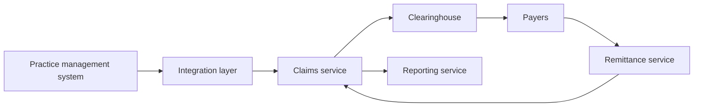

The Insurance Billing platform is built as a set of services behind a single web application. Clearinghouse, payer, and practice management connections run through an integration layer so that billing logic stays in one place.

## Components

| Component | Responsibility |
| --- | --- |
| Web application | User interface for billing staff, managers, and front-desk users |
| API gateway | Authenticates requests and routes them to services |
| Claims service | Builds, scrubs, and tracks claims through submission |
| Eligibility service | Sends 270/271 inquiries and stores benefit responses |
| Remittance service | Parses 835 files and posts payments and adjustments |
| Reporting service | Builds scheduled and on-demand reports from the reporting store |
| Integration layer | Maps practice management and EHR data to billing records |

## Data flow

## Environments

| Environment | Purpose | Data |
| --- | --- | --- |
| Sandbox | Integration testing with clearinghouse test payers | Synthetic patients only |
| Staging | Pre-release validation | Anonymized copy of production configuration |
| Production | Live claims and payments | Protected health information |

## Security

- All traffic uses TLS 1.2 or later.
- Data is encrypted at rest with AES-256.
- Access is role-based, and every change to a claim is written to an audit log.
- Protected health information is stored only in the production region.

## Related

- [Claim submission](/insurance-billing/claim-submission)
- [Reporting](/insurance-billing/reporting)
